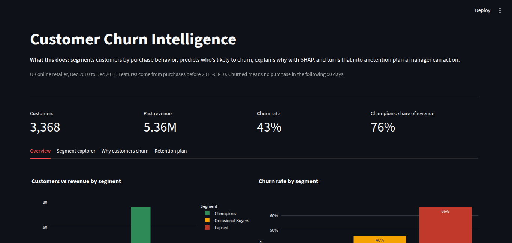
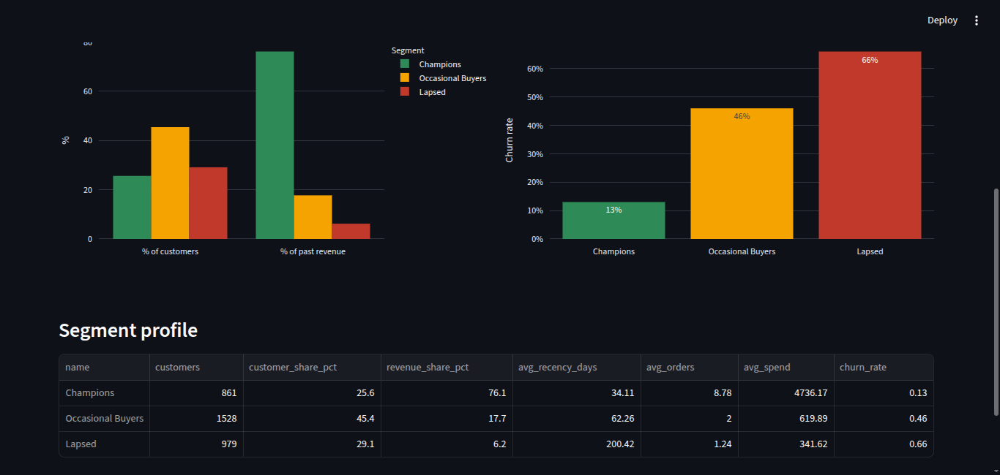

<div align="center">



<br/>


**A customer churn project that segments buyers, predicts who is likely to leave, explains why with SHAP, and turns it into a retention plan a manager can act on.**

[Preview](#-preview) | [Key insights](#-key-insights) | [How it works](#-how-it-works) | [Run it](#-run-it-locally) | [Author](#-author)

</div>

<br/>

## At a glance



<br/>

> **Data:** UK online retailer, Dec 2010 to Dec 2011. Features come from purchases before **2011-09-10**. A customer counts as **churned** if they made no purchase in the following **90 days**.


## 📸 Preview

<p align="center">
  
</p>

<p align="center">
  
</p>

The Streamlit app has 4 tabs:

| Tab | What it shows |
|---|---|
| **Overview** | KPI cards, customers vs revenue by segment, churn rate by segment, segment profile table |
| **Segment explorer** | Drill into each customer segment |
| **Why customers churn** | SHAP explanations of what pushes a customer toward churn |
| **Retention plan** | Suggested actions a manager can use, generated with the Gemini API |


## 💡 Key insights



<br/>

| Segment | Customers | Revenue share | Avg days since last order | Avg orders | Avg spend | Churn rate |
|---|---:|---:|---:|---:|---:|---:|
| 🟢 **Champions** | 861 (25.6%) | **76.1%** | 34 | 8.8 | 4,736 | **13%** |
| 🟠 **Occasional Buyers** | 1,528 (45.4%) | 17.7% | 62 | 2.0 | 620 | 46% |
| 🔴 **Lapsed** | 979 (29.1%) | 6.2% | 200 | 1.2 | 342 | **66%** |

- **Overall churn is 43%** across 3,368 customers.
- **Champions are the business.** About a quarter of customers bring 76% of revenue, and they churn the least (13%). Losing one costs far more than losing a Lapsed customer.
- **Occasional Buyers are the biggest group** (45.4%) with just 2 orders on average and a 46% churn rate, so they have the most room to become repeat buyers.
- **Lapsed customers** last ordered about 200 days ago, churn at 66% and add only 6.2% of revenue.

<!-- TODO: add 1-2 findings from the "Why customers churn" (SHAP) tab, e.g. the top features that drive churn. -->


## ⚙️ How it works



<br/>

| Step | What happens | Tool |
|---|---|---|
| 1. **Data** | Online Retail transactions from the UCI repository | Excel file |
| 2. **Clean** | Remove bad rows and build clean customer transactions with SQL | DuckDB, SQL |
| 3. **Features** | RFM (recency, frequency, monetary) features plus a churn label using the 2011-09-10 cutoff | Python, SQL |
| 4. **Model** | Train a churn prediction model | XGBoost |
| 5. **Explain** | Show which features push a customer toward churn, and group customers into 3 segments | SHAP, KMeans |
| 6. **Act** | Turn the results into a retention plan inside the dashboard | Gemini API, Streamlit |

## 🧰 Tech stack

| Tool | Used for |
|---|---|
| **Python** | Pipeline scripts and modeling |
| **DuckDB + SQL** | Data cleaning, RFM and feature building |
| **XGBoost** | Churn prediction |
| **SHAP** | Explaining model predictions |
| **KMeans** | Customer segmentation |
| **Streamlit** | Interactive 4-tab dashboard |
| **Gemini API** | Retention plan suggestions |

## 📁 Project structure

```
churn-intelligence/
├── README.md
├── app.py                  # Streamlit dashboard
├── data_prep.py            # load the raw data
├── sql/                    # cleaning, RFM and feature queries
├── train.py                # XGBoost churn model
├── explain.py              # SHAP explanations
├── segment.py              # KMeans customer segments
├── llm_insights.py         # Gemini retention plans
├── requirements.txt
├── data/                   # raw dataset (not included, see below)
├── assets/                 # animated graphics used in this README
│   ├── banner.svg
│   ├── kpi-strip.svg
│   ├── pipeline.svg
│   ├── segment-bars.svg
│   └── divider.svg
├── images/                 # dashboard screenshots
│   ├── 01-overview-dashboard.png
│   └── 02-segment-profile.png
└── .gitignore
```

## 🚀 Run it locally

1. **Get the code.** Download this repo (green **Code** button, then **Download ZIP**) or clone it.
2. **Install the packages.**
   ```bash
   pip install -r requirements.txt
   ```
3. **Get the data.** Download the [Online Retail dataset from UCI](https://archive.ics.uci.edu/dataset/352/online+retail) and save it as `data/online_retail_II.xlsx`. It is not in this repo because of its size.
4. **Run the pipeline** in order:
   ```bash
   python data_prep.py
   python train.py
   python explain.py
   python segment.py
   ```
5. **Add your Gemini key** (only needed for the Retention plan tab). Create a `.env` file in the project root:
   ```
   GEMINI_API_KEY=your_key_here
   ```
6. **Start the dashboard.**
   ```bash
   streamlit run app.py
   ```

## ⚠️ Limitations

- The data covers one UK online retailer from Dec 2010 to Dec 2011, so results may not carry over to other businesses.
- "Churn" here means no purchase in the 90 days after 2011-09-10. A different window or cutoff would change the numbers.
- Retention plans are LLM-generated suggestions and should be reviewed by a person before use.

## 🎓 Skills shown in this project

SQL data cleaning, RFM analysis, feature engineering, churn modeling with XGBoost, model explainability with SHAP, customer segmentation with KMeans, and dashboard storytelling with Streamlit.

---

## 👤 Author

**Lakshay Gupta** | Aspiring Data Analyst, Delhi, India

[](https://github.com/LoG1604)
[](https://linkedin.com/in/lakshay-gupta-17b7ba244)

Email: lakshayguptabsr@gmail.com

<div align="center">

If this project helped you, a ⭐ on the repo is appreciated.

</div>
